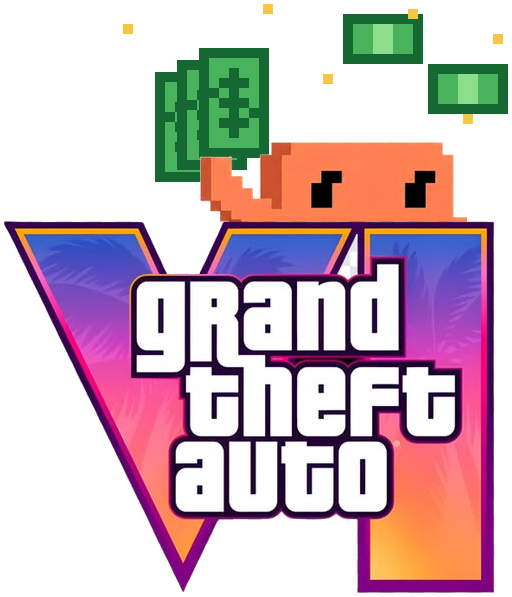

<div align="center">



<h1 align="center">gtavi-claudecode</h1>

<p align="center"><b>Rockstar made the game.<br>Claude Code makes you the money.</b></p>

<p align="center">GTA 6 is about to break the internet. Claude Code watches the biggest streams, catches the second chat explodes and hands you a ready-to-post vertical clip. Campaigns pay per 1,000 views. You just hit post.</p>

<p align="center">   </p>
<p align="center"> </p>
<p align="center"><sub>Unofficial fan project. Not affiliated with Rockstar Games, Take-Two or Anthropic.</sub></p>
<p align="center"><a href="#first-run-paste-this-into-claude-code">Quick start</a> · <a href="#two-ways-to-make-money">Make money</a> · <a href="#whats-inside">Skills</a> · <a href="#the-rules-that-make-clips-win">Clip rules</a> · <a href="#run-the-scripts-yourself">Scripts</a></p>

</div>

```
/plugin marketplace add Bodila51/gtavi-claudecode
/plugin install gtavi-claudecode@gtavi-claudecode
```

Two lines in Claude Code. In 10 minutes you have: the tools installed, your page folder, today's trending GTA 6 videos, the best moments picked and your first vertical clips ready to post.

## First run: paste this into Claude Code

```
Use gtavi-claudecode. Set up my GTA 6 clip page, ask me your 4 questions in one message,
then do everything after one "yes": find live clipping campaigns, show today's trending
GTA 6 videos and live streams, find the best moments in the top one, cut my first 3 clips
with hooks, check them against the campaign rules, and tell me what to post where.
```

## Two ways to make money

**1. Paid clipping campaigns (fastest).** Streamers and brands pay clippers per 1,000 views on approved clips. On Whop Content Rewards around $1 per 1K views is common; every campaign shows its own rate, budget left and rules. `campaign-finder` reads them live and never guesses a number. You read the rules, clip only that creator, post, submit the link.

**2. Your own faceless GTA 6 page (bigger, slower).** The built-in playbook runs it: daily content mix, credit rules, caption templates, the launch-day "be first" plan and a learning loop. Platforms don't pay for reposted clips, so the page grows on speed, useful tips and credited clips, then earns through campaigns and partnerships.

No income is promised. Your result depends on speed, picks and hooks, and the scoreboard shows what works.

## The rules that make clips win

- Hook in the first second. Say why to keep watching ("the hidden car nobody found").
- 7 to 30 seconds. Cut dead air at the start, end on the payoff.
- Big captions in the safe area. Most people watch muted.
- Make it yours: hook, tip, commentary. Never a plain re-upload. Credit the creator in your post.
- Launch day (Nov 19): players in New Zealand and Australia unlock first. Clip their streams, post to X first, then Reels, TikTok and Shorts, every 1 to 2 hours for 48 hours.
- Every repeated question in your comments becomes a HOW TO post.
- One test per day. No verdict before 24 hours, prefer the 72 h numbers.

## What's inside

| Skill | What you get |
|---|---|
| `setup` | Installs ffmpeg, yt-dlp and faster-whisper, asks 4 questions, builds your page folder |
| `campaign-finder` | Live campaigns: rate per 1K views, budget left, rules, link |
| `trend-radar` | GTA 6 videos from the last 24 h ranked by views per hour |
| `stream-finder` | Who is streaming GTA 6 right now, ranked by viewers |
| `moment-finder` | Best 15 to 40 s moments, scored by loudness spikes, hype words, YouTube "most replayed" and chat spikes |
| `live-mode` | Records a live stream and cuts a clip every time chat explodes |
| `twitch-reaction` | Reaction clips like the viral ones: the streamer's face on top, the game below, a big title on the seam. Finds the top GTA 6 Twitch streams with no account, reads chat and finds the webcam by itself |
| `clip-cutter` | 1080x1920 clip: word-by-word captions, hook box, -14 LUFS. Fill, blurred background or facecam on top |
| `hook-writer` | 3 hook options per clip |
| `rule-check` | Length, format, hashtags and banned content checked before you post |
| `multilang` | One clip in 5 languages: translated word-by-word captions and hook in ES, PT, DE, RU, optional stock-voice hook. Non-English GTA pages are almost empty |
| `questions-to-posts` | Pulls repeated questions from GTA subreddits and your comments, turns the answered ones into HOW TO posts |
| `secrets-map` | Builds a database of hidden spots, money, cars and collectibles from clips, with timestamp and credit. Verified ones become evergreen tip posts |
| `cheat-codes` | All reported GTA 6 cheat codes with unlock tasks and sources, turned into a 4-slide cheat carousel |
| `playbook` | Your full daily routine and launch-day plan |
| `learning-loop` | Scoreboard, one test per day, payouts from real numbers only |

Nothing is uploaded automatically. You approve every post.

## Hard rules

No leaks, no "play early" or "free download" posts, no piracy, no GTA Online money or AFK bots, no fake news, never pretends to be Rockstar. Every fact needs an official source.

## Run the scripts yourself

```
pip install -r requirements.txt
python scripts/trends.py --query "gta 6" --hours 24
python scripts/streams.py --query "gta 6"
python scripts/moments.py "https://www.youtube.com/watch?v=..." --top 8
python scripts/cut.py jobs/<id> --pick 2 --layout facecam --hook "Nobody noticed this"
python scripts/check.py jobs/<id>/edits/clip_2.mp4 --campaign campaigns.md
python scripts/live.py "https://www.youtube.com/watch?v=<live>" --minutes 60
```

Windows, macOS or Linux, Python 3.10+. An NVIDIA GPU makes transcription faster; on the CPU a 12-minute video takes about 5 minutes.

MIT license.
